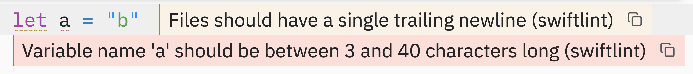

# EFM Language Server for Zed

A connector for [efm-langserver](https://github.com/mattn/efm-langserver), the general-purpose language server.

It adds LSP support to traditional linters and formatters by acting as a proxy.

<div align="center">
  <picture>
    <source media="(prefers-color-scheme: dark)" srcset=".assets/dark.png" />
    <source media="(prefers-color-scheme: light)" srcset=".assets/light.png" />
    
  </picture>
</div>

## Example

1. Install [`efm-langserver`](https://github.com/mattn/efm-langserver#installation), [`swiftformat`](https://github.com/nicklockwood/SwiftFormat#how-do-i-install-it), and [`swiftlint`](https://github.com/realm/SwiftLint#installation) on macOS.

    ```shell
    brew install efm-langserver swiftformat swiftlint
    ```

2. Add `efm-langserver` to the `Swift` language[^1].

    ```jsonc
    {
    	"languages": {
    		"Swift": {
    			"language_servers": ["efm-langserver", "..."],
    			"formatter": {
    				"language_server": { "name": "efm-langserver" },
    			},
    		},
    	},
    }
    ```

3. Configure the `efm-langserver` command[^2] and settings[^3].

    > The `path` key is optional if the binary is already in `$PATH`. On macOS, run `which efm-langserver` to confirm.

    ```jsonc
    {
    	"lsp": {
    		"efm-langserver": {
    			"binary": {
    				// "path": "/opt/homebrew/bin/efm-langserver",
    				"arguments": [
    					"-logfile",
    					"/tmp/efm-langserver.log",
    					"-loglevel",
    					"5",
    				],
    			},
    			"initialization_options": {
    				"documentFormatting": true,
    			},
    			"settings": {
    				"languages": {
    					"swift": [
    						{
    							"formatStdin": true,
    							"formatCommand": "swiftformat stdin --quiet --output stdout --stdinpath ${INPUT}",
    							"lintStdin": true,
    							"lintAfterOpen": true,
    							"lintIgnoreExitCode": true,
    							"lintSource": "swiftlint",
    							"lintFormats": [
    								"%l:%c:%trror:%m",
    								"%l:%c:%tarning:%m",
    							],
    							"lintCommand": "swiftlint lint --quiet --reporter json --use-stdin ${INPUT} | jq -r '.[] | [.line, (.character // 1), (.severity | ascii_downcase), .reason] | join(\":\")'",
    						},
    					],
    				},
    			},
    		},
    	},
    }
    ```

    ```sh
    # .swiftformat
    --indent tab
    ```

    ```yaml
    # .swiftlint.yml
    parent_config: ~/.config/.swiftlint.yml
    disabled_rules: trailing_newline
    ```

    ```yaml
    # ~/.config/.swiftlint.yml
    disabled_rules: identifier_name
    ```

[^1]: https://zed.dev/docs/languages

[^2]: https://github.com/mattn/efm-langserver#usage

[^3]: https://github.com/mattn/efm-langserver/blob/master/schema.md

## Development

https://github.com/navtoj/zed-efm-langserver/blob/dbb997f8cf9a9302f2f41eda6de43c66509fe9cd/extension.toml#L20-L22

If a language you need is missing, [create an issue](https://github.com/navtoj/zed-efm-langserver/issues/new?title=[Language]+change_me&body=File+Extension%3A+change_me&labels=enhancement%2Cgood+first+issue) or [submit a pull request](https://github.com/navtoj/zed-efm-langserver/fork?default_branch_only=true).
