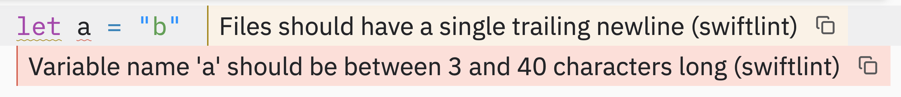

# EFM Language Server for Zed

A connector for [efm-langserver](https://github.com/mattn/efm-langserver), the general-purpose language server.

It adds LSP support to traditional linters and formatters by acting as a proxy.

<div align="center">
  <picture>
    <source media="(prefers-color-scheme: dark)" srcset=".assets/dark.png" />
    <source media="(prefers-color-scheme: light)" srcset=".assets/light.png" />
    
  </picture>
</div>

## Guide

1. Pick a [language](https://zed.dev/docs/languages); for example, `Swift`.
2. Find [binary](https://github.com/mattn/efm-langserver#installation) path; on macOS, run `which efm-langserver`.
3. Add [flags](https://github.com/mattn/efm-langserver#usage); for example, `-logfile efm.log`.
4. Add [configuration](https://github.com/mattn/efm-langserver/blob/master/schema.md); alternatively, use [config.yaml](https://github.com/mattn/efm-langserver#example-for-configyaml) file.

```jsonc
// ~/.config/zed/settings.json
{
	"languages": {
		"<name>": { // Step 1
			"language_servers": [
				"efm-langserver",
				"...",
			],
		},
	},
	"lsp": {
		"efm-langserver": {
			"binary": {
				"path": "to/executable", // Step 2
				"arguments": [
					// Step 3
				],
			},
			"settings": {
				// Step 4
			},
		},
	},
}
```

## Example

1. Install `efm-langserver` and [`swiftlint`](https://github.com/realm/SwiftLint) on macOS.

    ```shell
    brew install efm-langserver swiftlint
    ```

2. Add `efm-langserver` to the `Swift` language.

    ```jsonc
    {
    	"languages": {
    		"Swift": {
    			"language_servers": ["efm-langserver", "..."],
    		},
    	},
    }
    ```

3. Configure the `efm-langserver` path and arguments.

    > The `path` key is optional if the binary is already in `$PATH`.

    ```jsonc
    {
    	"lsp": {
    		"efm-langserver": {
    			"binary": {
    				// "path": "/opt/homebrew/bin/efm-langserver",
    				"arguments": [
    					"-logfile",
    					"/tmp/efm-langserver.log",
    					"-loglevel",
    					"5",
    				],
    			},
    		},
    	},
    }
    ```

4. Configure the `swiftlint` command and formats.

    ```jsonc
    {
    	"lsp": {
    		"efm-langserver": {
    			"settings": {
    				"languages": {
    					"swift": [
    						{
    							"lintStdin": true,
    							"lintOnSave": false,
    							"lintAfterOpen": true,
    							"lintIgnoreExitCode": true,
    							"lintSource": "swiftlint",
    							"lintFormats": [
    								"%l:%c:%trror:%m",
    								"%l:%c:%tarning:%m",
    							],
    							"lintCommand": "swiftlint lint --use-stdin --quiet --no-cache --reporter json | jq -r '.[] | [.line, (.character // 1), (.severity | ascii_downcase), .reason] | join(\":\")'",
    						},
    					],
    				},
    			},
    		},
    	},
    }
    ```

    By default, `swiftlint` will look for `.swiftlint.yml` in the project (`cwd`) directory.

    ```yaml
    # .swiftlint.yml
    parent_config: ~/.config/.swiftlint.yml
    disabled_rules: trailing_newline
    ```

    ```yaml
    # ~/.config/.swiftlint.yml
    disabled_rules: identifier_name
    ```

    > Nested configurations are [disallowed in official docs](https://github.com/realm/SwiftLint#nested-configurations) when using either `--config path/to/file` in `lintCommand` or `lintStdin`/`--use-stdin`.

## Development

https://github.com/navtoj/zed-efm-langserver/blob/8ae0a6ba50872d007f764045a9942af4b4e7f718/extension.toml#L20-L22

If a language you need is missing, [create an issue](https://github.com/navtoj/zed-efm-langserver/issues/new?title=[Language]+change_me&body=File+Extension%3A+change_me&labels=enhancement%2Cgood+first+issue) or [submit a pull request](https://github.com/navtoj/zed-efm-langserver/fork?default_branch_only=true).

### Known Issues

- https://github.com/mattn/efm-langserver/issues/315
